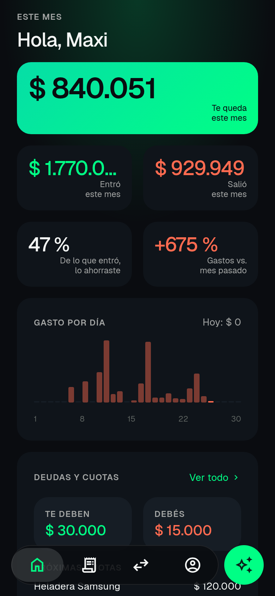
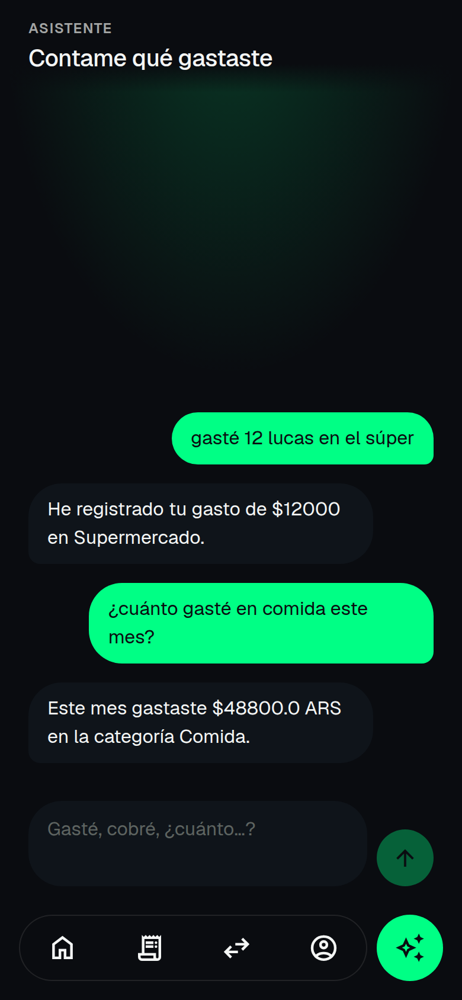
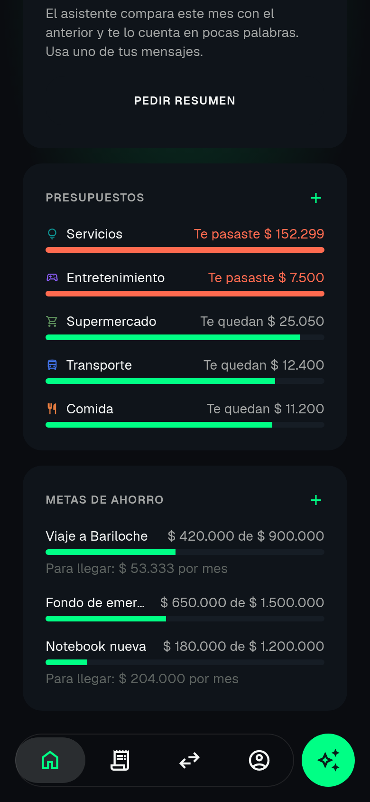
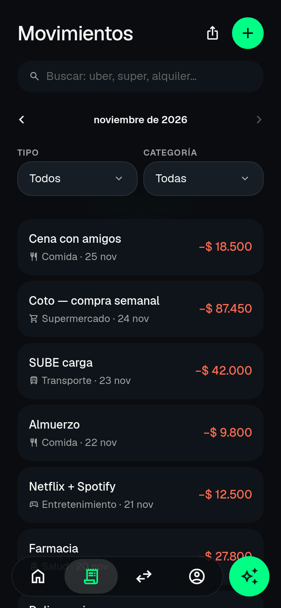
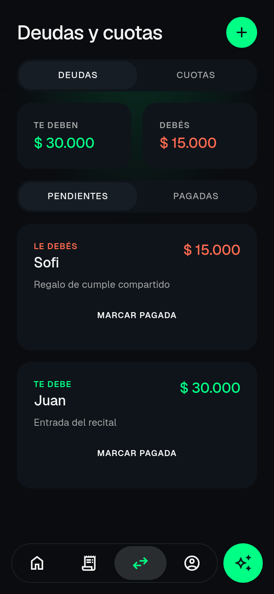
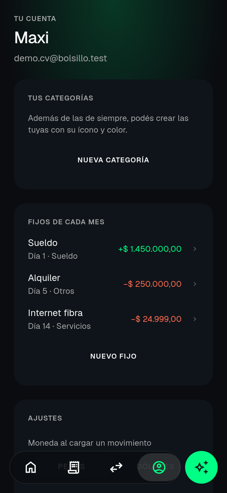
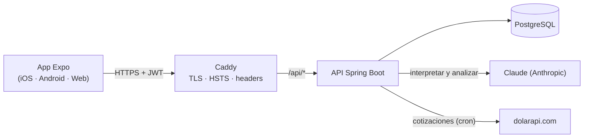

# Bolsillo

**App de finanzas personales con un asistente de IA.** Le contás qué gastaste como se lo dirías a un amigo ("gasté 12 lucas en el súper") y el asistente lo registra, lo categoriza y responde preguntas sobre tus gastos.

Backend en **Spring Boot 4 + PostgreSQL** y app móvil en **Expo / React Native**, con tests de integración, CI, escaneo de seguridad y deploy en contenedores.

<p align="center">
  
  
  
</p>
<p align="center">
  
  
  
</p>

## Funcionalidades

- **Asistente conversacional:** detecta la intención del mensaje (registrar, consultar, corregir o charlar), extrae monto, moneda y categoría, y aprende alias propios ("el chino" → Supermercado). Arma un resumen del mes comparado con el anterior.
- **Multimoneda:** ARS y USD, con cotizaciones oficial, blue, MEP y tarjeta que se actualizan solas durante el día.
- **Movimientos:** búsqueda, filtros por tipo y categoría, y exportación a CSV.
- **Presupuestos** mensuales por categoría, con aviso cuando te pasás.
- **Metas de ahorro**, con cuánto tenés que separar por mes para llegar.
- **Deudas** (te deben / debés) y **compras en cuotas**, con la próxima cuota a vencer.
- **Movimientos fijos** (sueldo, alquiler, servicios) que se cargan solos cada mes.
- **Categorías propias**, con ícono y color.

## Stack

| | |
|---|---|
| **Backend** | Java 21, Spring Boot 4 (Web, Security, Data JPA, Validation), PostgreSQL 16, Flyway, JWT (jjwt), WebClient |
| **IA** | Claude (Anthropic): Haiku para interpretar mensajes y Sonnet para análisis. El proveedor es configurable (Anthropic o Gemini) |
| **App** | Expo SDK 58, React Native, Expo Router, Reanimated, Secure Store, TypeScript |
| **Tests** | JUnit 5 + Testcontainers (PostgreSQL real), 190 tests |
| **Infra** | Docker multi-stage, Docker Compose, Caddy (HTTPS), GitHub Actions, GHCR, Dependabot |

## Arquitectura



La API está organizada **por módulo de negocio** (`auth`, `transactions`, `chat`, `budgets`, `goals`, `recurring`, `debts`, `purchases`, `exchangerates`, `metrics`…), cada uno con su controller, service, repository y DTOs.

**Cómo funciona el asistente:** el modelo no tiene acceso a la base. Recibe el mensaje y un contexto compacto con las métricas del usuario, y devuelve un JSON con la intención y los datos. El backend valida ese JSON y ejecuta la acción siempre con el usuario del token, así que un mensaje malicioso no puede tocar datos de otra persona. Cada usuario tiene una cuota mensual de mensajes de IA, que se descuenta en una operación atómica.

## Decisiones técnicas destacadas

- **Montos en centavos (`long`)** y conversión a ARS guardada con la cotización del día, para no arrastrar errores de punto flotante ni recalcular el historial.
- **Refresh tokens rotativos:** se guarda solo el hash SHA-256 y, si alguien reusa un token, se revocan todas las sesiones del usuario.
- **Aislamiento entre usuarios:** todas las consultas filtran por el usuario autenticado, incluidas las de SQL nativo.
- **Perfiles `dev` y `prod`:** prod no tiene valores por defecto y no arranca si falta una variable o si detecta un secreto de desarrollo.
- **Migraciones versionadas** con Flyway e Hibernate en modo `validate`.

## Seguridad

- **Autenticación:** contraseñas con BCrypt, límite de intentos de login y de registro guardado en la base, JWT de 15 minutos y CORS explícito.
- **Errores:** las respuestas no muestran stacktraces ni detalles internos, y en producción solo se expone `/actuator/health`.
- **Entradas:** todas se validan (tamaños, montos, moneda), y el CSV exportado se protege contra inyección de fórmulas.
- **App:** el token se guarda en el Keychain/Keystore, el build de release exige HTTPS y Android no respalda los datos de la app.
- **Infraestructura:**
  - Caddy con TLS 1.2/1.3, HSTS, CSP y cabeceras de seguridad.
  - Contenedores sin root, en solo lectura y sin capabilities.
  - La base no se expone a internet.
  - Backups diarios cifrados con [age](https://age-encryption.org).
- **CI:** gitleaks sobre todo el historial, Trivy sobre la imagen Docker (falla con CVE críticas o altas que tengan arreglo) y Dependabot semanal.

## CI/CD

Cada PR corre los tests del backend con Testcontainers, el chequeo de tipos y el lint de la app, el build de la imagen Docker, gitleaks y Trivy. Al mergear a `main`, la imagen se publica en GitHub Container Registry y se puede desplegar por SSH a un VPS, con verificación de salud por HTTPS.

## Correrlo en local

Requisitos: Docker, Java 21 y Node 22.

```bash
cp .env.example .env
```

```bash
docker compose --profile api up -d --build
```

```bash
cd mobile && npm install && npx expo start --web
```

Más detalle (pgAdmin, Swagger, variables de entorno y deploy en un VPS) en [`docs/DESARROLLO.md`](docs/DESARROLLO.md).

## Licencia

© 2026 MaxiEscobarGit. Todos los derechos reservados.

El código se publica solo para consulta, como portfolio. No se otorga permiso para usarlo, copiarlo, modificarlo ni distribuirlo.
